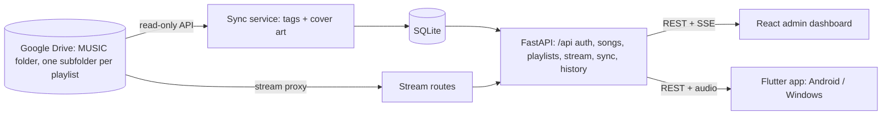

# Sondra: Personal Music Streaming Platform

A private music streaming system for your own audio collection. Your songs stay in a Google Drive folder; a FastAPI backend reads them through the Drive API, indexes tags and cover art, and streams them to a React admin dashboard and to Flutter apps for Android and Windows.

**Links:** [GitHub](https://github.com/shriram-s7/sondra)

## Overview

Commercial streaming services do not carry your own rips and recordings, and copying a large library onto every device is tedious. Sondra treats Google Drive as the single source of truth: each subfolder of a chosen root folder becomes a playlist, a background sync scans the folders and extracts metadata, and the backend proxies the audio so clients never need Drive credentials. The database is disposable, because on a fresh start the backend rebuilds it from Drive. It is a single-user system with one admin login.

## Features

**Backend**
- Sync service that scans the Drive root folder on an interval, reads tags and embedded cover art (mutagen) for `.mp3`, `.flac`, `.m4a` and `.wav` files, and pushes Server-Sent Events so connected clients refresh.
- Streaming through a read-only proxy with range support, a direct-link option with refresh, and a listen counter.
- Playlists (one per Drive subfolder), song search, play history and a "continue listening" list.
- JWT login for a single admin, with password change.

**Admin dashboard** (React, served at `/admin/` or deployed separately)
- Dashboard, library, playlists and settings views, with a player and selectable colour palettes.

**Flutter app** (`app/`, Android and Windows)
- Playback with background audio and media controls, queue, now-playing screen and a mini player.
- Offline playlists and downloads, plus Windows system media transport controls.

## How it works



On startup (and on a timer) the backend syncs the library. Because free hosting resets the SQLite file on each redeploy, a full sync runs at startup so the database is rebuilt from Drive. Google credentials can be supplied as files locally or as environment variables on a host with no persistent disk.

## Tech stack

| Layer | Technology |
|---|---|
| Backend | Python, FastAPI, SQLAlchemy, SQLite, python-jose (JWT), mutagen, httpx |
| Storage | Google Drive API (`drive.readonly`) via google-api-python-client |
| Admin UI | React, TypeScript, Vite |
| Client apps | Flutter, Riverpod, just_audio, audio_service, dio |
| Hosting | Render (API), Vercel (admin UI), optional UptimeRobot ping |
| Windows installer | Inno Setup (`app/windows/inno_setup.iss`) |

## Project structure

```text
backend/    FastAPI app: main.py, models.py, database.py, gdrive.py, routers/ (auth, songs, playlists, stream, sync, history), static/ (built admin UI)
admin/      React + Vite admin dashboard source
app/        Flutter client (lib/ providers, screens, services, widgets; android/ and windows/ platform code)
start.bat, start.sh   local launchers
render.yaml, Procfile   Render deployment
.env.example            environment variable template
```

## Getting started

Prerequisites: Python 3, a Google account, and (for the admin UI source or the apps) Node.js and Flutter.

### 1. Google Cloud credentials (one time)

1. In the [Google Cloud Console](https://console.cloud.google.com/) create a project and enable the **Google Drive API**.
2. Create an **OAuth client ID** of type **Desktop app** (configure the consent screen as External and add the `drive.readonly` scope), download the JSON and save it as `backend/credentials.json`.

### 2. Environment variables

Copy `.env.example` to `.env` and set (see the file for placeholders):

| Variable | Purpose |
|---|---|
| `ADMIN_USERNAME`, `ADMIN_PASSWORD` | the single admin login (the password can be changed from Settings) |
| `JWT_SECRET` | secret used to sign login tokens; use a long random value |
| `GDRIVE_ROOT_FOLDER_ID` | ID (or URL) of your music root folder |
| `GDRIVE_OAUTH_CREDS` | path to the OAuth credentials file (default `credentials.json`) |
| `SYNC_INTERVAL_SECONDS` | sync frequency; the code defaults to 900 |
| `GDRIVE_CREDS_JSON`, `GDRIVE_TOKEN_JSON` | the credentials and token JSON as strings, for hosts without files (Render) |
| `CORS_ORIGINS` | allowed origins for a separately hosted admin UI |

### 3. Run it

**Windows:** double-click `start.bat`. **Linux / macOS:** `./start.sh`.

The first start opens a browser to authorise read-only Drive access and writes `backend/token.json`. Then open http://localhost:8000/admin/ and sign in with your admin credentials. Never commit `credentials.json`, `token.json` or `.env`.

## Usage

- Upload songs to subfolders of your Drive root folder; each subfolder is a playlist.
- The sync picks them up on the next interval (or trigger one from the admin dashboard), and open clients refresh through SSE.
- Open the admin dashboard to browse and play, or connect a Flutter app by entering your server URL and admin login.

## Deployment

**Backend on Render:** use `render.yaml` (Blueprint) or create a Web Service manually with build command `pip install -r backend/requirements.txt` and start command `cd backend && uvicorn main:app --host 0.0.0.0 --port $PORT`. Set `ADMIN_USERNAME`, `ADMIN_PASSWORD`, `JWT_SECRET`, `GDRIVE_ROOT_FOLDER_ID`, `CORS_ORIGINS` and paste the contents of your local `credentials.json` and `token.json` into `GDRIVE_CREDS_JSON` and `GDRIVE_TOKEN_JSON`.

**Admin UI on Vercel:** root directory `admin`, build command `npm run build`, output directory `dist`, and set `VITE_API_URL` to your backend URL.

**Keep the free backend awake:** create an UptimeRobot HTTP(s) monitor for `https://<your-render-url>/health` every 14 minutes.

**Flutter apps** (run from `app/`):

```bash
flutter build apk --release          # Android: app/build/app/outputs/flutter-apk/app-release.apk
flutter build windows --release      # Windows: app/build/windows/x64/runner/Release/
```

For a Windows installer, compile `app/windows/inno_setup.iss` with Inno Setup. In the app, enter your server URL and log in with the admin credentials.

## Tests

There is no automated test suite in this repository, and none was run while writing this README.

## Status and limitations

- Personal project; works end to end for one user and one Drive library.
- Single admin account with no per-user accounts; the backend falls back to development defaults for admin credentials and the JWT secret if environment variables are missing, so always set them.
- SQLite on free hosting is rebuilt from Drive on each start, so play history and any other local-only data can be lost on redeploy.
- Free Render hosting sleeps when idle; the first request can be slow.
- The built admin UI is committed under `backend/static/`; rebuild it from `admin/` after UI changes.
- Not tested here: the Flutter builds, Drive authorisation and the hosted deployment.

## License

No license specified.
